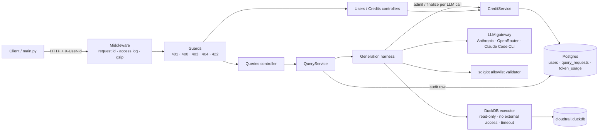
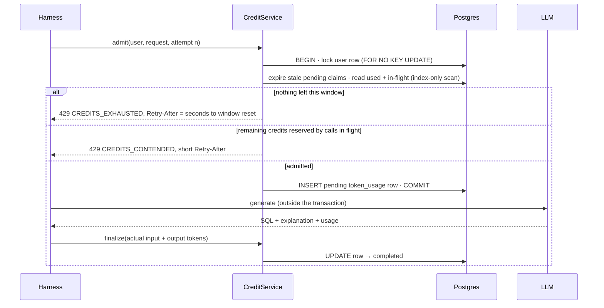

# Agentic Threat Hunting: hypothesis → SQL, with per-user credits

An LLM service that turns a threat-hunting hypothesis ("Attackers use GetCallerIdentity to see which account they're in")
into a DuckDB SQL query over 1.9M AWS CloudTrail events. It runs the query, explains it, and corrects itself when the
SQL fails. Every LLM call is metered against a per-user token budget in Postgres: 200K tokens per fixed 6-hour UTC
window, with HTTP 429 and `Retry-After` when the budget runs out.

| Document | What's in it |
|---|---|
| [`APPROACH.md`](APPROACH.md) | Design: schema, APIs, admission logic, harness, evaluation, prompting, iteration log |
| [`EVALUATION_REPORT.md`](EVALUATION_REPORT.md) | Results: before/after, expected vs found per hypothesis, limitations |
| [`DECISIONS.md`](DECISIONS.md) | Every design decision with its reason (D1–D50) |
| [`evaluation_dashboard.html`](evaluation_dashboard.html) | The evaluation as one page: download and open it in a browser |

**Result:** strict score **0.50 → 0.79** across 11 hypotheses (prompt v1 → v2, plus self-correction and value checks).

## Quick start (Docker)
Needs Docker and Python 3.12 (Python only for `main.py`).

```bash
# 1. Dataset: download nineteenFeaturesDf.csv into ./data/
#    https://www.kaggle.com/datasets/nobukim/aws-cloudtrails-dataset-from-flaws-cloud
cp .env.example .env          # 2. set ANTHROPIC_API_KEY (or LLM_PROVIDER=openrouter + OPENROUTER_API_KEY)
make up                       # 3. Postgres → one-time CSV-to-DuckDB conversion → API on :8000
make install && .venv/bin/python main.py   # 4. full evaluation over HTTP → runs/<timestamp>_<prompt>/
```

Then try it:
```bash
curl -X POST localhost:8000/v1/users -H 'Content-Type: application/json' -d '{"user_id":"analyst-1"}'
curl -X POST localhost:8000/v1/queries -H 'Content-Type: application/json' -H 'X-User-Id: analyst-1' \
  -d '{"title":"Root Access Through Console","hypothesis":"Root user console login attempts can be identified in CloudTrail logs","max_rows":20}'
curl localhost:8000/v1/users/analyst-1/credits -H 'X-User-Id: analyst-1'
```
Interactive API docs: http://localhost:8000/docs.

**Local development** (API outside Docker): `make install`, `make db-up`, `make prepare-data`, `make dev`.

## How it works


Each `POST /v1/queries` runs the harness: **build prompt → generate → validate → execute → zero-row value check →
explain**. If the SQL is rejected, fails, times out, or returns 0 rows because a filter value doesn't exist in the data,
the reason goes back to the LLM for another attempt (up to `MAX_SELF_CORRECT`). Every attempt is a separately admitted and
billed LLM call:



A 429 on the first attempt means the LLM is never called. If credits run out during self-correction, the request ends
with `status: "failed"` and `CREDITS_EXHAUSTED_MIDWAY`. Overshoot is at most one call (APPROACH §7.3).

## API
| Method & path | Header | Purpose | Codes |
|---|---|---|---|
| `POST /v1/users` | none | Create a user (`user_id`, `token_limit` optional) | 201 · 409 · 422 |
| `POST /v1/queries` | `X-User-Id` | Hypothesis → SQL, explanation, confidence, results, trace, usage | 200 · 401 · 400 · 404 · 422 · 429 · 502 · 504 |
| `GET /v1/users/{id}/credits` | `X-User-Id` = `{id}` | Used / remaining tokens in the current window, reset time | 200 · 401 · 403 · 404 |
| `GET /v1/users/{id}/usage` | `X-User-Id` = `{id}` | Every LLM call in the current window | 200 · 401 · 403 · 404 |
| `GET /healthz` | none | DB + DuckDB status, LLM provider, harness configuration | 200 · 503 |

Every error uses one envelope, `{"error": {"code", "message", "details"}, "request_id"}`, and every response echoes
`X-Request-Id`. Full contracts: APPROACH §6.

## Evaluation
```bash
python main.py                                   # live run: fresh user, all 11 hypotheses, sequential
python main.py --only 1,9a                       # subset
python main.py --replay runs/<run>               # re-score saved responses, no API calls
python main.py --compare runs/<before> runs/<after>   # diff + evaluation_dashboard.html
```
Each run writes `runs/<timestamp>_<prompt>/`: the raw responses, `run_config.json` (the server's exact settings from
`/healthz`), `evaluation_results.json` and `report.md`. A live run of all hypotheses also copies `evaluation_results.json`
to the repo root. Scoring is strict and explained in APPROACH §9 and [`EVALUATION_REPORT.md`](EVALUATION_REPORT.md).

To reproduce the two official runs, start the API with these settings, then run `python main.py`:

| Run | Server settings |
|---|---|
| before | `PROMPT_VERSION=v1 MAX_SELF_CORRECT=0 ZERO_ROW_VALUE_CHECK=false` |
| after | `PROMPT_VERSION=v2 MAX_SELF_CORRECT=2 ZERO_ROW_VALUE_CHECK=true` (the defaults) |

**Future scope** (APPROACH §18): an ablation across five configurations with 3 repeated runs each, to attribute the
gain to the prompt, self-correction and the value check and to measure run-to-run variance; and a frozen held-out set
of 3–4 new hypotheses (e.g. IAM privilege escalation, snapshot sharing) to show whether the v2 rules generalise.

## Tests
```bash
make test          # starts Postgres, runs unit + integration tests (69) on the separate test database
make lint          # ruff + mypy
.venv/bin/pytest -m live   # opt-in: one real hypothesis through the configured LLM and the real dataset
```
The integration tests include the brief's rate-limit cases: a request within the limit is recorded, an exhausted user
gets a 429 without an LLM call, credits return after the window boundary (fake clock), concurrent requests can't
overspend, and usage persists across a restart. The LLM is replaced by a scripted fake gateway; DuckDB runs on a
5-row fixture built with the real build code.

## Configuration
Everything comes from `.env` (see [`.env.example`](.env.example)); the app refuses to start on an invalid value. The
most important settings:

| Setting | Default | Meaning |
|---|---|---|
| `LLM_PROVIDER` | `anthropic` | `anthropic`, `openrouter` or `claude_code` (local CLI on a Claude subscription, dev only) |
| `LLM_MODEL` / `OPENROUTER_MODEL` | `claude-sonnet-5-5` / `anthropic/claude-sonnet-5.5` | Model per provider |
| `TOKEN_LIMIT_DEFAULT` | 200000 | Tokens per user per window |
| `WINDOW_HOURS` | 6 | Fixed UTC windows; must divide 24 |
| `MAX_CALL_TOKENS` | 15000 | Worst-case tokens reserved per in-flight call (measured, D37) |
| `PROMPT_VERSION` | `v2` | Folder under `prompts/` |
| `MAX_SELF_CORRECT` | 2 | Extra attempts after a failed one |
| `ZERO_ROW_VALUE_CHECK` | true | Retry when 0 rows come from a value that doesn't exist |
| `MAX_RESULT_ROWS` | 10000 | Row cap; `total_rows` always gives the true count |

The official runs used `LLM_PROVIDER=openrouter` with the free `nvidia/nemotron-3.5-super-vl:free` model (D44).

## Using another dataset
The harness, credits, API and evaluator don't depend on CloudTrail. To point the service at another log table:
1. **Data prep:** adapt `scripts/prepare_data.py` / `app/modules/query_engine/dataset.py`: the CSV path, `COLUMNS`, the
   table/view name and the time column. The build also produces the schema card the prompt uses.
2. **SQL allowlist:** update `ALLOWED_COLUMNS` in `app/modules/query_engine/allowlist.py`.
3. **Prompt:** copy `prompts/v2/` to a new version and rewrite the domain sentences (role, data facts). The schema card
   is injected automatically.
4. **Evaluation:** supply your own hypotheses and answer key in the same format, and adjust the dataset-specific notes.

## Project layout
```
api.py  main.py  query_generator.py  evaluator.py   # entry points named in the brief
schema.sql                                         # Postgres schema (source of truth, applied at startup)
app/core/       config, logging, errors, middleware, clock
app/common/     guards (X-User-Id → 401/400/404/403)
app/modules/    users · credits (policy, admission) · queries · harness · llm · query_engine
evaluation/     loaders · normalizers · metrics · scorer · report · dashboard · runner · cli
prompts/v1 v2/  system, user and retry templates (prompts are files, never code)
runs/           the official before/after evaluation runs
tests/          unit · integration (Postgres) · live (opt-in)
```
